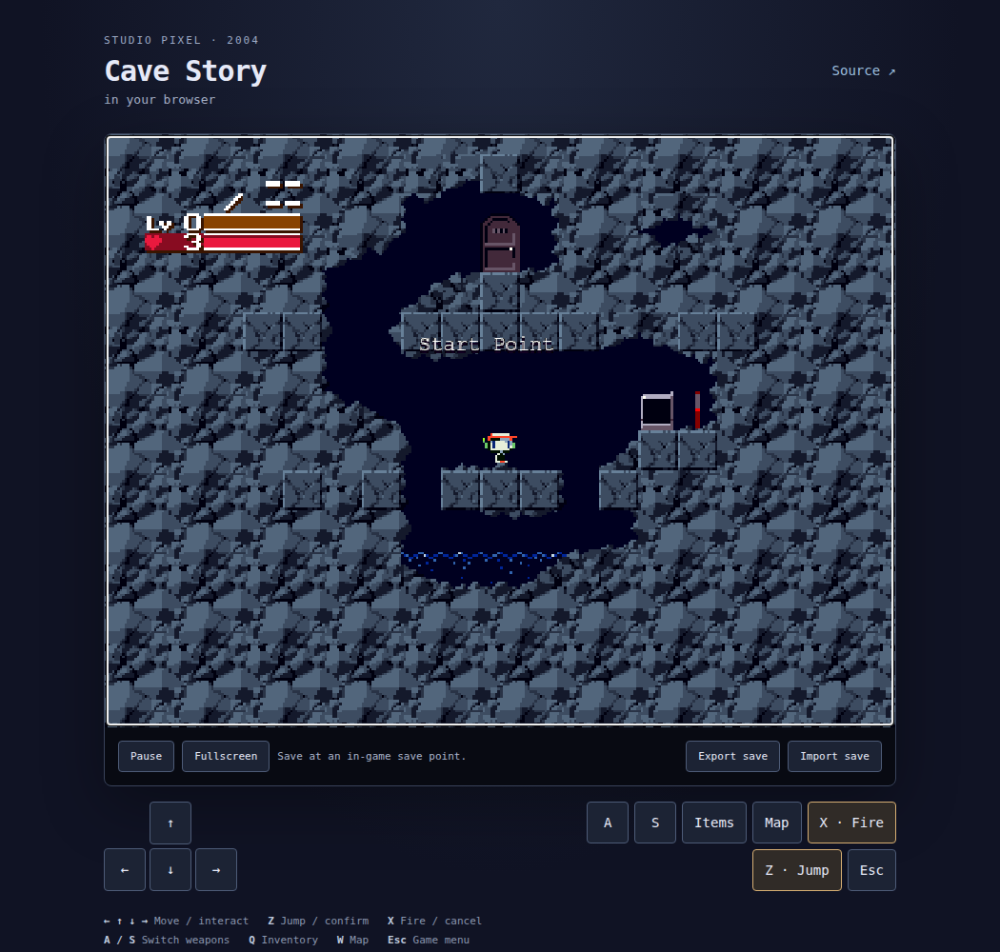

# cavestory-wasm

The original freeware **Cave Story in your browser**, compiled to WebAssembly from the [CSE2 decompilation](https://github.com/gameblabla/CSE2/tree/emscripten). Includes English and Japanese, the full game engine and original game data, audio, touch controls, and browser saves with import/export.

**[Play in your browser](https://flintsh.github.io/cavestory-wasm/)**



This builds on an existing CSE2 browser port. It is not an official source release or a new decompilation. See [source, changes, and fidelity](docs/PROVENANCE.md) and [verification](docs/VERIFICATION.md). The original code/assets remain proprietary; see [LICENCE.txt](LICENCE.txt).

## Build and run

Install [Emscripten](https://emscripten.org/docs/getting_started/downloads.html) **4.0.21** and Python 3, then:

```sh
git clone https://github.com/FlintSH/cavestory-wasm.git
cd cavestory-wasm
source /path/to/emsdk/emsdk_env.sh
python3 scripts/build.py
python3 -m http.server 8000 --directory dist
```

Open **http://localhost:8000**, choose a language, and press Play. Use HTTP, rather than opening `index.html` directly.

Arrow keys move; **Z** jumps/confirms; **X** shoots/cancels; **A/S** switch weapons; **Q** opens inventory; **W** opens the map; **Esc** opens the game menu. Save at the game's save points. Saves stay in this browser; Export save backs up an original-format `Profile.dat`.

## Deploy

Upload the contents of **`dist/`** to any static web host. Serve `.wasm` as `application/wasm`. No backend, cross-origin isolation, or runtime dependencies are required.

For GitHub Pages, set **Settings → Pages → Source → GitHub Actions**. The included workflow builds both languages, runs browser tests, and deploys every successful push to `main`.

## Verify

```sh
python3 scripts/verify-assets.py
npm ci
npx playwright install --with-deps chromium
npm test
```

Browser test reports include screenshots, recordings, and failure traces. Cave Story © Daisuke “Pixel” Amaya; English translation by Aeon Genesis. CSE2 by cuckydev, Clownacy, and contributors.
